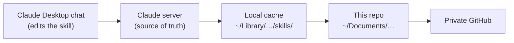

# Job Application System

Version control and audit trail for Rishwanth Katam's job-application skills —
four Claude skills that tailor CVs and cover letters from verified evidence
rather than from memory or by rewriting old drafts.

This repo is the **record**, not the runtime. The skills execute inside Claude;
this is where every accepted change to them is committed, so `git log` reads as
a human-facing history of what changed, on whose authority, and what it cost.

---

## The four skills

| Skill | What it does |
|---|---|
| `jd-recruiter-brief` | Analyses a job description into a structured brief. Runs first; feeds the rest. |
| `cv-tailoring` | Selects and generates CV content from the evidence layers. Holds the canonical data. |
| `cover-letter` | Drafts a cover letter in Rishwanth's established style. |
| `application-qa` | Final pre-submission check — length, fabrication, keyword coverage, consistency. |

### Why it's built in layers

`cv-tailoring` stores facts in four layers, used in this order:

```
evidence/*.md          full ground truth per role/project (7 files)
index/*.facts.json     every atomic fact, searchable (7 files, 88 facts)
bullet-bank.json       cached CV-ready renderings (53 bullets)
facts.yaml             canonical facts, claim locks, skills bank
```

The evidence layer exists because an earlier bullet-only design silently lost
any fact that had never been written into a bullet. The `validate.py` provenance
check exists because a demo bullet once invented a "3 months" duration that
appeared in no evidence file. Both fixes are permanent constraints, not history.

---

## How a change reaches this repo



The flow is **one-way**. Editing the local cache changes nothing the skill can
see — verified 2026-08-09 by exporting the `.skill` archives and diffing. All
skill edits must be made from inside a Claude Desktop chat.

The cache *does* refresh automatically once a change lands server-side, which is
why no manual export is needed.

---

## Making a change

Governed by `change_protocol` in
[`cv-tailoring/references/workflow-rules.yaml`](cv-tailoring/references/workflow-rules.yaml).
Steps 1–7 happen in the chat; step 8 happens here.

1. Analyse the source, corroborate it, price the change (steps 1–5).
2. Present findings. **Implement only on Rishwanth's explicit approval** (step 6).
3. Write the `CHANGELOG.md` entry — source, corroboration, what was rejected and
   why, cost paid (step 7).
4. On the laptop, run (step 8):

```bash
~/Documents/job-application-system/sync-and-commit.sh
```

That makes one commit using the changelog entry as its message, and pushes.
`--dry-run` shows the diff first. The Claude Desktop chat cannot run this — its
sandbox has no access to the laptop.

---

## Rules that matter

- **`facts.yaml` and `evidence/*.md` are near-immutable.** They change only when
  Rishwanth corrects a fact from a primary source — never from an article, a JD,
  or a generated draft.
- **`CHANGELOG.md` is written by hand for every change.** Git version-controls
  it; it does not replace it. The commit message *is* the entry, verbatim, so
  the two cannot drift apart.
- **One commit per accepted change. Never squash.** A squashed commit destroys
  the mapping between a decision and its consequence, which is the only thing
  this repo exists to preserve.
- **Commit directly to `main`.** The review gate is already upstream at step 6.

---

## Files

```
cv-tailoring/          canonical data, evidence, index, bullet bank, master CVs
cover-letter/          style rules and five real sample letters
jd-recruiter-brief/    JD analysis prompt
application-qa/        pre-submission keyword coverage check

sync-and-commit.sh     step 8 — commit and push an approved change
GIT_WORKFLOW.md        full workflow: architecture, branch strategy, drift checks
APPLY_TO_SERVER.md     paste-ready prompt for applying edits via Desktop chat
.gitignore             what is excluded, and why
```

## Checking for drift

Before relying on the facts for an application:

```bash
~/Documents/job-application-system/sync-and-commit.sh --dry-run
```

"No changes" means the live skills match the last approved commit. An unexpected
modification to `facts.yaml` or `evidence/` should be investigated before
submitting anything — this system exists to prevent fabrication, and an
unexplained edit to a fact file is exactly that failure.

---

*Private repository. Contains full employment evidence, reference-letter content
and three master CVs.*
